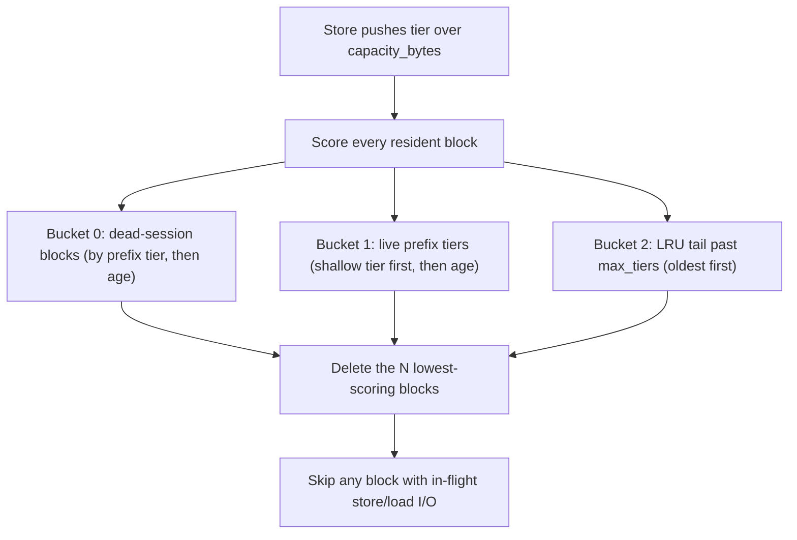

# Storage-Tier Eviction: Session Prefix Pruning

This document describes the eviction policy for the **filesystem (`fs`) secondary
tier** of the [`OffloadingConnector`](kv_offloading_usage.md) and every knob that
controls it. It is a companion to the main
[KV Offloading Usage Guide](kv_offloading_usage.md); read that first for the
connector overview, the `TieringOffloadingSpec`, and the FS tier basics.

## Why this exists

By default the `fs` tier is **unbounded**: every completed block is written to
`root_dir` and never deleted. On a finite disk (an EBS volume, an NVMe mount, a
PVC) that eventually fills up. The storage-tier eviction policy puts a **byte
budget** on the tier and, when the budget is exceeded, deletes blocks in a
principled order instead of letting the filesystem fill or forcing a manual
cleanup.

The policy is the storage-tier port of the CPU primary tier's
`prefix_pruning_on_sessions` policy. It shares the exact same scoring order
(the two tiers reuse the same core in
`vllm/v1/kv_offload/eviction/prefix_pruning_core.py`), so the behavior described
below matches the CPU tier's `eviction_policy` of the same name, with two
storage-specific differences noted in [Differences from the CPU tier](#differences-from-the-cpu-tier).

## Eviction order in one sentence

When the tier is over budget, blocks are deleted **lowest-value first** in this
order:

1. **Blocks of a session predicted dead** — a conversation that appears to be
   over — in prefix order (shallowest token first).
2. **Live prefix tiers** — blocks of still-active sessions, shallowest
   prefix tier first (the shared system prompt / early context is cheapest to
   recompute and most likely already cached elsewhere).
3. **The LRU tail** — blocks whose end-token position is past `max_tiers`
   tiers deep, oldest first.



Blocks with an **in-flight store or load** are never deleted, regardless of
score (see [Safety semantics](#safety-semantics)).

## Enabling it

Byte-bounded behavior is **off unless** `capacity_bytes` is set on the `fs`
tier entry. The per-tier `eviction_policy` then selects the mode:

| `eviction_policy` | Behavior when over `capacity_bytes` |
| --- | --- |
| `"lru"` (default) | Delete least-recently-used resident blocks |
| `"prefix_pruning"` / `"prefix_pruning_on_sessions"` | Session/prefix-aware eviction (this document) |
| `"reject"` / `"none"` | Reject new stores (no deletion); hard-cap baseline |

!!! warning "Per-tier, not top-level"
    The top-level `eviction_policy` in `kv_connector_extra_config` controls the
    **CPU primary tier**. The storage-tier policy is a **separate** key placed
    **inside the `fs` tier's dict** in `secondary_tiers`. They are independent
    and have independent knobs. Setting the top-level `eviction_policy` does not
    affect the `fs` tier, and vice versa.

If a non-default `eviction_policy` is set without `capacity_bytes`, the tier
warns and stays unbounded. The rest of this document describes the
**prefix-pruning** policy; LRU uses the same `capacity_bytes` budget and
in-flight I/O protection but orders victims by recency only (`touch` / store
bumps MRU).

### Example (adapted from a multi-tier deployment)

Starting from the unbounded command, enabling a 500 GiB bounded, session
prefix-pruned `fs` tier means adding `capacity_bytes` and `eviction_policy` to
the tier entry:

```bash
VLLM_KV_CONNECTOR_HIT_LOG=1 \
PYTHONHASHSEED=0 \
VLLM_SERVER_DEV_MODE=1 \
vllm serve poolside/Laguna-XS-2.1 \
  --host 127.0.0.1 --port 8000 \
  --gpu-memory-utilization 0.9 \
  --max-model-len 262144 \
  --kv-transfer-config '{
    "kv_connector": "OffloadingConnector",
    "kv_role": "kv_both",
    "kv_connector_extra_config": {
      "spec_name": "TieringOffloadingSpec",
      "cpu_bytes_to_use": 107374182400,
      "block_size": 256,
      "eviction_policy": "lru",
      "secondary_tiers": [
        {
          "type": "fs",
          "root_dir": "/mnt/ebs/",
          "n_read_threads": 32,
          "n_write_threads": 16,
          "capacity_bytes": 536870912000,
          "eviction_policy": "prefix_pruning",
          "session_dead_ttl_s": 200,
          "max_tiers": 8
        }
      ]
    }
  }'
```

Here the top-level `"eviction_policy": "lru"` governs the CPU tier; the `fs`
tier is independently bounded at `capacity_bytes` and pruned with
`prefix_pruning`.

## How the byte budget maps to blocks

Every offloaded chunk on the `fs` tier is one fixed-size file. The budget is
therefore a cap on the number of resident chunks:

```text
max_chunks = capacity_bytes // bytes_per_chunk
```

`bytes_per_chunk` is the size of one offloaded chunk (determined by the model,
dtype, number of KV groups, and `block_size` / `blocks_per_chunk`). With
`block_size: 256`, each chunk covers 256 tokens of KV, so a larger `block_size`
means fewer, larger files for the same budget. `capacity_bytes` must be at least
one chunk, or construction fails.

A chunk counts against the budget from the moment its **store is submitted**
(not when it lands on disk), so concurrent in-flight stores cannot overshoot
the cap. Eviction is evaluated on every store submission: if the tier is over
budget, enough resident blocks are selected and deleted to bring it back within
budget (best-effort — see [Safety semantics](#safety-semantics)).

## Session liveness: when is a session "dead"?

A **session** groups a multi-turn conversation. The tier learns a session's id
from the request: first `ReqContext.session_id`, falling back to
`kv_transfer_params["session_id"]`. Blocks are tagged with the session that last
stored or touched them. Set `session_id` per request (e.g. via
`kv_transfer_params`) to get session-aware eviction; without it, sessions play
no role and eviction degrades to prefix-tier + age order.

The detector measures **think time** — the idle gap between a session's last
turn finishing and its next turn arriving:

- On each new arrival, the gap since the previous finish is recorded as a sample.
- A session is declared **dead** once its current idle time exceeds a threshold:

  ```text
  threshold = max(session_dead_ttl_s, ewa_gap + session_dead_k * std_gap)
  ```

  where `ewa_gap` / `std_gap` are the exponentially-weighted average and
  standard deviation of that session's observed gaps.

- The first observed gap **seeds** the average (it is not blended toward zero).
- Until a session has at least `session_min_gaps` samples, the static floor
  `session_dead_ttl_s` is used alone.
- A session whose latest turn is **still in flight** (an arrival with no
  matching finish yet) is never dead, no matter how long ago.

This adaptivity means a session that habitually pauses ~2 minutes between turns
is not wiped at a fixed 200 s; its own rhythm raises the bar. A session that
replies in seconds and then goes silent is reclaimed quickly.

Two detector modes are available via `session_detector`:

- `"ewa"` (default): per-session EWA threshold as above.
- `"global"`: the adaptive term is a quantile (`session_quantile`) over a
  rolling window (`session_gap_window`) of **all** sessions' gaps, rather than
  the per-session EWA. Useful when individual sessions are too short-lived to
  build their own statistics but the fleet has a stable gap distribution.

Setting `session_dead_ttl_s: 0` **disables** the dead-session bucket entirely —
eviction then uses only prefix tiers and the LRU tail (pure prefix pruning).

## Prefix tiers: how blocks within a session are ranked

A block's **prefix tier** is derived from its end-token position in the
sequence, so shallow (early-context) blocks and deep (late) blocks are treated
differently:

```text
tier(pos) = 0                                              if pos <= first_tier_tokens
tier(pos) = 1 + (pos - first_tier_tokens - 1) // tier_step_tokens   otherwise
```

- Tier 0 is the first `first_tier_tokens` tokens (the shared system prompt /
  early context). It is evicted **first** among live blocks: cheapest to
  recompute and most likely still resident elsewhere (CPU tier, another
  instance's cache).
- Each subsequent `tier_step_tokens` tokens form the next tier.
- A block ending exactly on a tier boundary stays in the lower tier.
- `max_tiers` caps how many tiers are treated as "prefix". Blocks at or beyond
  `max_tiers` fall into the **LRU tail** (bucket 2), ordered purely by age so
  the deep, long-lived suffix of an active session is protected from
  prefix-order peeling and only reclaimed by recency. `max_tiers: 0` leaves the
  prefix tiers **uncapped** (no LRU tail; everything is scored by tier).

Within every bucket, ties break by **age** (older blocks, i.e. those stored
longer ago, go first), then by block hash for determinism.

## Knobs reference

All knobs are **per-`fs`-tier** keys placed directly in the tier's dict inside
`secondary_tiers`. Defaults match the CPU `prefix_pruning_on_sessions` arm.

| Key | Default | Valid range | Meaning |
| --- | --- | --- | --- |
| `capacity_bytes` | `None` (unbounded) | `>= bytes_per_chunk` | Byte budget for the tier. Reduces to `capacity_bytes // bytes_per_chunk` chunks. Required for all eviction/reject modes. |
| `eviction_policy` | `"lru"` | `"lru"` / `"prefix_pruning"` / `"prefix_pruning_on_sessions"` / `"reject"` / `"none"` | Selects LRU eviction, prefix-pruning eviction, or reject-on-full. All require `capacity_bytes`. |
| `first_tier_tokens` | `16384` | `>= 1` | Token span of prefix tier 0 (the shallowest, evicted-first tier among live blocks). |
| `tier_step_tokens` | `16384` | `>= 1` | Token span of each tier after tier 0. |
| `max_tiers` | `8` | `>= 0` | Number of prefix tiers before blocks fall into the recency-only LRU tail. `0` = uncapped (no tail). |
| `session_dead_ttl_s` | `200.0` | `>= 0` | Static idle-time floor (seconds) before a session can be dead. `0` disables the dead-session bucket. |
| `session_ewa_alpha` | `0.3` | `(0, 1]` | EWA smoothing for a session's think-time gap statistics. Higher = react faster to recent gaps. |
| `session_dead_k` | `3.0` | `>= 0` | Std-dev multiplier in the adaptive threshold `ewa + k*std`. Higher = more conservative (sessions die later). |
| `session_min_gaps` | `2` | `>= 0` | Minimum observed gaps before the adaptive threshold replaces the static floor. |
| `session_detector` | `"ewa"` | `"ewa"` or `"global"` | Per-session EWA detector vs. a global rolling-quantile detector. |
| `session_quantile` | `0.95` | `(0, 1)` | Quantile used by the `"global"` detector over the gap window. Ignored for `"ewa"`. |
| `session_gap_window` | `256` | `>= 1` | Rolling-window size (number of gaps) for the `"global"` detector. |

Out-of-range values are rejected at startup with a `ValueError`, so a bad
config fails fast rather than silently misbehaving.

## Safety semantics

- **In-flight protection.** A block with an in-flight store (being written) or
  in-flight load (being promoted to the CPU tier for a GPU read) is never a
  deletion candidate. Deleting a file mid-transfer would corrupt a read or race
  a write.
- **Asynchronous, best-effort deletes.** Victims are deleted on the tier's
  write-priority thread pool, off the scheduler thread, so eviction never blocks
  scheduling. Deletes are best-effort: an already-missing file is not an error.
  If, in a burst, too few deletable (resident, unprotected) blocks exist to get
  back under budget in one pass, the tier is briefly over budget until
  subsequent store completions make more blocks evictable.
- **Lookup cache invalidation.** When a block is evicted, its cached lookup
  verdict is dropped so a later lookup re-probes the disk and sees the file is
  gone (returns `MISS`). A re-stored block can become a `HIT` again.
- **Single-writer / local assumption.** Eviction assumes this instance owns the
  files under its rank directory. Only files **written during this process's
  lifetime** are tracked and counted against the budget; pre-existing files
  from a prior run that shares the same `root_dir` are not indexed and are not
  evicted. This is safe for the normal case where each instance writes under its
  own `_r<rank>` directory (see the FS [On-Disk Layout](kv_offloading_usage.md#on-disk-layout)).
  If you need the budget to also account for files left by previous runs, clear
  stale `root_dir` subdirectories before starting (or restart with a clean
  directory).

## Differences from the CPU tier

The storage policy is the same scoring core as the CPU
`prefix_pruning_on_sessions` policy, with two deliberate differences:

- **No GPU idle-TTL demote.** The CPU/GPU arm has an idle-TTL pressure valve
  that demotes live prefixes under small-GPU pressure. On storage that would
  peel a live prefix before a dead session's suffix, so it is intentionally
  omitted.
- **No ref-counted physical slots.** The CPU tier evicts ref-counted buffer
  slots atomically (all-or-nothing). The storage tier has one file per block and
  evicts best-effort, protecting only in-flight-I/O blocks, since a cold file on
  disk has no equivalent of a pinned read.

## Tuning guidance

- **Start with the defaults.** They mirror the CPU arm and are a sensible
  baseline for multi-turn chat workloads.
- **`capacity_bytes` is the primary lever.** Size it to the usable space on the
  mount minus headroom. Bigger budget = higher hit rate and less eviction churn.
- **Multi-turn chat:** keep `session_dead_ttl_s` near the longest think time you
  want to preserve across turns; raise `session_dead_k` to be more forgiving of
  bursty sessions. Lower `session_dead_ttl_s` to reclaim space from finished
  conversations faster.
- **Batch / single-turn workloads with no session ids:** sessions won't form, so
  leave `session_dead_ttl_s` at the default (it is harmless) and rely on
  prefix-tier + age order; `first_tier_tokens` / `tier_step_tokens` / `max_tiers`
  then dominate behavior.
- **Very long contexts:** increase `max_tiers` (or set it to `0`) so a deep but
  active suffix isn't repeatedly peeled; increase `first_tier_tokens` if your
  shared prefix is large and you want it treated as a single evict-first tier.
- **Many short sessions:** switch `session_detector` to `"global"` so the
  threshold is learned fleet-wide rather than per-session.

## Observability

### Eviction log lines

The tier logs when eviction is active, so the server log clearly shows when the
budget was first hit and how blocks are being reclaimed:

- **At startup**, when eviction is enabled, an INFO line reports the configured
  budget:

  ```text
  Storage tier 'fs' prefix-pruning eviction enabled: capacity=536870912000 bytes (N blocks).
  ```

- **On the first eviction**, and then **at most once every 30 s**, an INFO line
  summarizes activity with the bucket breakdown and current occupancy:

  ```text
  Storage tier 'fs' eviction active: evicted 12 block(s) this pass;
  cumulative total=4096 (dead_session=3100, live_prefix=900, lru_tail=96);
  occupancy=2097152/2097152 blocks (536870912000/536870912000 bytes).
  ```

  The breakdown tells you *why* blocks are leaving: a high `dead_session` share
  means finished conversations are being reclaimed (healthy); a high
  `live_prefix` or `lru_tail` share means the working set exceeds
  `capacity_bytes` and active data is being peeled.

- **Every eviction pass** is also logged at DEBUG (`evicted N block(s)`), and a
  transient "over capacity but all candidates have in-flight I/O; deferring
  eviction" DEBUG line fires if a burst temporarily pins every candidate. Raise
  the server log level to `DEBUG` for per-pass detail.

The INFO summary is throttled (first event plus once per 30 s) so a continuously
full tier does not flood the log while still making the onset and ongoing rate
of eviction visible for analysis.

### Hit rate

Enable this instance's hit logging (as in the example,
`VLLM_KV_CONNECTOR_HIT_LOG=1`) and watch the storage-tier hit rate before and
after enabling eviction. A healthy configuration keeps the disk within
`capacity_bytes` while preserving the storage-tier hit rate; a steep hit-rate
drop after enabling eviction usually means `capacity_bytes` is too small for the
working set, or `session_dead_ttl_s` is too aggressive for your think times.
